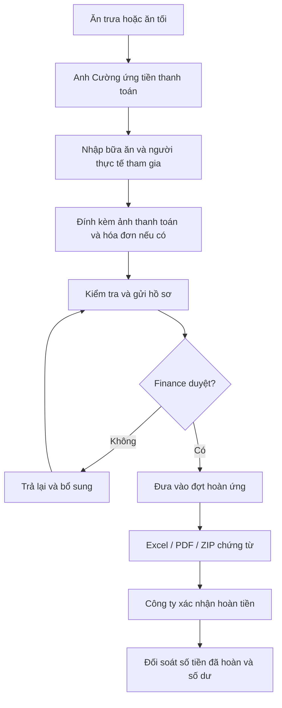
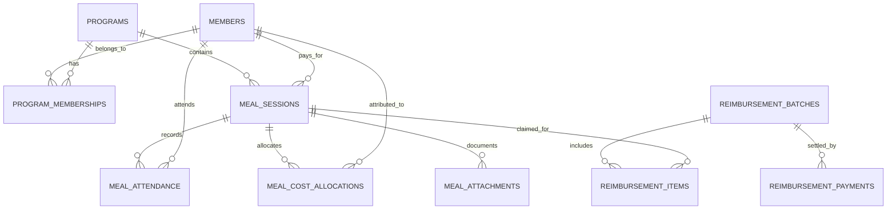

# HORUS LEADERSHIP MEALS
## Tài liệu đặc tả sản phẩm và nghiệp vụ (PRD + Functional Specification)

| Thuộc tính | Thông tin |
|---|---|
| Tên dự án | Horus Leadership Meals — Quản lý ăn trưa, ăn tối, người tham gia và hoàn ứng |
| Tổ chức | Horus Entertainment |
| Phiên bản tài liệu | 1.0 |
| Ngày cập nhật | 27/10/2026 |
| Người đề xuất / người ứng tiền mặc định | Doãn Thế Cường |
| Ngôn ngữ / múi giờ / tiền tệ | Tiếng Việt / Asia/Ho_Chi_Minh (UTC+7) / VND |
| Trạng thái | Đặc tả yêu cầu để triển khai; các mục ghi **Cần xác nhận** chưa phải quyết định chính thức |

> **Mục tiêu quan trọng:** Ứng dụng phải trả lời được trong một tháng: có bao nhiêu bữa ăn, ai tham gia bao nhiêu lần, tỷ lệ tham gia của mỗi người là bao nhiêu, cả nhóm đã chi bao nhiêu, chi phí *phân bổ* của từng nhân sự là bao nhiêu, anh Cường đã ứng bao nhiêu tiền và công ty còn phải hoàn ứng bao nhiêu. Các số liệu phải truy vết được tới từng bữa ăn và ảnh chứng từ.

---

## 1. Bối cảnh và mục tiêu

### 1.1. Bối cảnh

Horus Entertainment tổ chức các bữa ăn nội bộ nhằm tạo không gian trao đổi kiến thức, góc nhìn, thông tin công ty và xã hội, thúc đẩy tư duy học hỏi và tăng sự gắn kết của đội ngũ. Doãn Thế Cường trực tiếp đứng ra thanh toán trước; sau đó ghi nhận chi phí kèm ảnh thanh toán và hóa đơn (nếu có) để công ty tổng hợp, đối soát và hoàn ứng.

Hệ thống phải phục vụ **hai chương trình độc lập về quản trị thành viên, lịch diễn ra và báo cáo**, đồng thời cho phép xem báo cáo gộp.

### 1.2. Hai chương trình

| Mã | Chương trình | Lịch dự kiến | Mục tiêu | Chính sách chi phí |
|---|---|---|---|---|
| `LEADERSHIP_LUNCH` | Leadership Lunch — Ăn trưa đội ngũ lãnh đạo/nhân sự chủ chốt | Hằng ngày | Knowledge sharing, cập nhật xã hội, kết nối, grow-up mindset, phối hợp liên phòng ban | Công ty chi trả 100% |
| `GAME_STRATEGY_DINNER` | Game Strategy Dinner — Ăn tối Ban Chiến lược Game | Tối thứ Năm hằng tuần | Sinh hoạt của Ban Chiến lược Game; nội dung thảo luận chi tiết **cần xác nhận** | Quy trình ứng trước/ghi nhận được yêu cầu; phạm vi công ty thanh toán **cần xác nhận** |

**Lưu ý:** Lịch dự kiến không đồng nghĩa với một bữa ăn đã diễn ra. Thống kê số buổi phải dựa trên các bữa ăn thực tế được ghi nhận, không tự động đếm mỗi ngày hay mỗi thứ Năm. Một ngày có thể có cả ăn trưa và ăn tối.

### 1.3. Mục tiêu đo lường được

1. Ghi nhận một bữa ăn và ảnh thanh toán trong một quy trình ngắn, thuận tiện trên điện thoại.
2. Truy vấn báo cáo theo tháng, năm, chương trình, nhân sự và trạng thái hoàn ứng.
3. Biết số lần/tỷ lệ tham gia của từng thành viên, có thể bấm vào để xem danh sách bữa ăn cụ thể.
4. Theo dõi tổng chi phí thực tế của nhóm và chi phí phân bổ theo từng người, không cộng trùng.
5. Xuất bảng kê Excel/PDF và chứng từ phục vụ kế toán hoàn tiền cho người đã ứng.
6. Theo dõi số tiền đã ứng, đang đề nghị hoàn, đã hoàn và còn chưa hoàn.
7. Có nhật ký chỉnh sửa để phục vụ đối soát và kiểm toán nội bộ.

### 1.4. Ngoài phạm vi phiên bản đầu

- Không thay thế phần mềm kế toán/ERP chính thức của công ty.
- Không tự chuyển khoản ngân hàng; chỉ ghi nhận thủ công số tiền công ty đã hoàn.
- Không tự xác minh tính hợp lệ pháp lý hoặc thuế của hóa đơn.
- Không mặc định đồng bộ hệ thống nhân sự/chấm công hoặc ngân hàng.
- Không mặc định suy ra danh sách tham gia từ danh sách thành viên được mời.

---

## 2. Thành viên và nhóm

### 2.1. Danh sách ban đầu của Leadership Lunch

| STT | Họ tên | Chức danh/bối cảnh đã biết | Trạng thái |
|---:|---|---|---|
| 1 | Nguyễn Duy Sơn | CEO | Thành viên |
| 2 | Doãn Thế Cường | CPO; người thanh toán mặc định | Thành viên |
| 3 | Huỳnh Kiều Xuân Trường | CTO Game | Thành viên |
| 4 | Nguyễn Đức Tùng | CTO AI | Thành viên |
| 5 | Chu Văn Mai | Lead Game Design | Thành viên |
| 6 | Nguyễn Văn Duệ | HRM / Trợ lý Chủ tịch | Thành viên |
| 7 | Trịnh Thị Ngọc Hân | Trợ lý HRM | Thành viên |
| 8 | Trần Việt Phú | Chức danh **chưa cung cấp** | Thành viên mới bổ sung |

Danh sách này được **quản lý động**, không viết cứng trong mã nguồn. Một người có thể thuộc nhiều chương trình; một người có thể gia nhập/ngừng tham gia từ một ngày nhất định mà lịch sử cũ không bị thay đổi.

### 2.2. Game Strategy Dinner

- Thành phần là **Ban Chiến lược Game**; **chưa có danh sách cụ thể**.
- Không mặc định toàn bộ 8 thành viên Leadership Lunch cũng thuộc Ban Chiến lược Game.
- Admin có quyền cấu hình danh sách và thời gian hiệu lực của từng thành viên.
- Có thể thêm khách mời theo từng bữa, nhưng khách mời được tách riêng khỏi KPI nhân sự nội bộ nếu cần.

### 2.3. Khái niệm quan trọng

- **Thành viên thuộc chương trình (member):** Có tư cách tham gia trong một khoảng thời gian.
- **Đủ điều kiện tham gia (eligible):** Là thành viên đang hiệu lực của chương trình tại ngày diễn ra bữa ăn; có thể mở rộng thành danh sách được mời từng buổi.
- **Tham gia thực tế (attendee):** Được đánh dấu có mặt ở một bữa ăn đã diễn ra.
- **Khách mời (guest):** Không bắt buộc thuộc danh sách nhân sự thường trực; vẫn có thể được tính chi phí phân bổ.
- **Người ứng/chi trả (payer):** Người thực sự thanh toán, mặc định là Doãn Thế Cường; không nhất thiết là người tham gia.

---

## 3. Vai trò và phân quyền

| Vai trò | Quyền chính |
|---|---|
| **Admin / Owner** | Quản lý chương trình, thành viên, phân quyền; tạo/sửa bữa ăn, danh sách có mặt, phân bổ, đợt hoàn ứng, xem tất cả báo cáo |
| **Payer / Submitter** | Tạo bữa ăn, thanh toán, tải chứng từ, gửi đề nghị hoàn ứng, xem lịch sử của khoản mình ứng |
| **Finance / Approver** | Xem chứng từ, kiểm tra chi phí, duyệt/từ chối, xác nhận đã hoàn ứng, tải báo cáo kế toán |
| **Viewer / Leadership** | Xem dashboard và dữ liệu trong phạm vi được cấp; không sửa hoặc duyệt chi phí |

Một tài khoản có thể có nhiều vai trò. Quyền xem **ảnh thanh toán, hóa đơn và dữ liệu hoàn ứng** phải cấp riêng, không mặc định mọi thành viên đều xem được.

---

## 4. Quy trình nghiệp vụ

### 4.1. Ghi nhận bữa ăn

1. Chọn **Thêm bữa ăn**.
2. Chọn chương trình: ăn trưa hoặc ăn tối thứ Năm.
3. Chọn **ngày giờ thực tế** và địa điểm/quán ăn.
4. Đánh dấu **những người có mặt thực tế** (mặc định gợi ý danh sách thành viên chương trình, **không tự động đánh dấu tất cả**).
5. Nhập **tổng số tiền đã thanh toán** bằng VND.
6. Chọn người thanh toán (mặc định Doãn Thế Cường), phương thức thanh toán và ghi chú nếu cần.
7. Tải **tối thiểu 1 ảnh chứng từ thanh toán**; có thể tải nhiều ảnh. Ảnh hóa đơn có thể bỏ trống.
8. Chọn phương pháp phân bổ chi phí và kiểm tra tổng phân bổ bằng tổng tiền thanh toán.
9. Lưu nháp hoặc **Gửi ghi nhận/đề nghị hoàn ứng**.
10. Nếu quy trình công ty yêu cầu, Finance duyệt; bữa ăn đủ điều kiện đưa vào đợt hoàn ứng.

**Trạng thái ghi nhận:** `DRAFT` → `SUBMITTED` → `APPROVED` hoặc `REJECTED`; có `VOIDED` khi hủy bản ghi. Người được quyền có thể sửa bản ghi bị trả lại và gửi lại; thao tác phải lưu lịch sử.

### 4.2. Tạo đợt hoàn ứng

1. Lọc các bữa ăn đã duyệt, người ứng là Doãn Thế Cường, còn số dư chưa hoàn.
2. Chọn một hoặc nhiều bữa ăn để lập **đợt hoàn ứng**.
3. Hệ thống tính tổng, liệt kê ngày, chương trình, quán ăn, số tiền, người thanh toán, chứng từ.
4. Xuất **Excel bảng kê**, **PDF trình ký/đối soát**, và tùy chọn **ZIP chứa ảnh chứng từ**.
5. Finance xác nhận việc công ty thanh toán: ngày hoàn, số tiền, người xác nhận, mã chuyển khoản/ghi chú.
6. Đợt được đánh dấu **đã hoàn** khi nhận đủ; đối với hoàn một phần, giữ dư nợ còn lại (hỗ trợ theo thiết kế dữ liệu; có thể triển khai ở giai đoạn sau).

**Không được biến việc tạo bảng kê thành sự kiện “đã thanh toán”.** Chỉ một giao dịch hoàn ứng thực sự đã xác nhận mới giảm số tiền còn phải hoàn.

### 4.3. Luồng trạng thái hoàn ứng

- `NOT_CLAIMED`: Chi phí đã được duyệt, chưa đưa vào đợt hoàn ứng.
- `CLAIMED`: Đã đưa vào đợt đang chờ xử lý.
- `PARTIALLY_REIMBURSED`: Đã hoàn một phần.
- `REIMBURSED`: Đã hoàn đủ.
- `REJECTED / RETURNED`: Hồ sơ bị trả lại; có lý do; không tự coi là đã hoàn.

Trạng thái hoàn ứng nên **được tính từ số tiền và giao dịch hoàn** thay vì gán tay tùy ý, nhằm tránh sai lệch.



---

## 5. Chức năng chi tiết

### F01 — Quản lý chương trình

- Thêm/sửa tên, mã, mô tả, lịch dự kiến, trạng thái hoạt động.
- Danh sách thành viên độc lập theo chương trình.
- Không xóa vật lý chương trình đã có giao dịch; chỉ vô hiệu hóa/ẩn.

### F02 — Quản lý nhân sự và lịch sử tư cách thành viên

- Lưu tên hiển thị, email/tài khoản (nếu có), chức danh tùy chọn, trạng thái.
- Quản lý ngày bắt đầu/ngừng tham gia **theo từng chương trình**.
- Cho phép một người tham gia nhiều chương trình, nhưng trong thống kê **tổng hợp số người duy nhất** không đếm trùng.
- Khách mời có nhãn riêng; quyết định có hiển thị trong KPI nhân sự hay không phải được cấu hình minh bạch.

### F03 — Quản lý bữa ăn

- Tạo/sửa/lưu nháp/hủy; nhập ngày, giờ, chương trình, địa điểm, số tiền, phương thức, người ứng, ghi chú.
- Phát hiện bữa ăn có khả năng ghi trùng: cùng chương trình, ngày, địa điểm, số tiền.
- Một ngày có thể nhiều bữa, kể cả cùng chương trình, nên cảnh báo trùng **không tự khóa**.
- Ghi lại ngày tạo, người tạo, ngày sửa, người sửa.

### F04 — Điểm danh người tham gia

- Danh sách checkbox theo chương trình; có tìm kiếm tên.
- Lưu danh sách có mặt theo từng bữa, cho phép bổ sung thành viên không thường trực/khách mời.
- Ngăn đếm trùng một người hai lần trong cùng một bữa.
- Không suy đoán vắng mặt từ việc không có mặt trong danh sách mời; nếu cần thống kê vắng mặt, đối chiếu danh sách đủ điều kiện.

### F05 — Ảnh thanh toán và hóa đơn

- **Bắt buộc** có ≥1 ảnh chứng từ thanh toán khi gửi hồ sơ; cho phép lưu nháp chưa có ảnh.
- **Không bắt buộc** có hóa đơn; hỗ trợ nhiều ảnh hóa đơn/tài liệu PDF.
- Xem ảnh thu nhỏ, mở ảnh gốc, tải xuống, gắn loại chứng từ, thời điểm tải lên.
- Kiểm tra kích thước/định dạng file; đề xuất JPG, PNG, WEBP, HEIC (chuyển đổi hiển thị nếu cần) và PDF cho hóa đơn.
- Lưu file trên vùng riêng tư, có phân quyền và đường dẫn ký thời hạn; không đặt toàn bộ chứng từ trong thư mục công khai.
- Nếu chứng từ bị thay đổi sau khi duyệt, ghi audit và yêu cầu duyệt lại theo quy tắc công ty.

### F06 — Phân bổ chi phí cho từng nhân sự

Đây là chức năng cần thiết để trả lời câu hỏi “mỗi nhân sự tốn bao nhiêu tiền trong tháng”.

**Phân biệt bắt buộc:**

- **Tổng chi phí thực chi của một bữa:** Số tiền thực sự trả cho quán, dùng để đối soát công ty và hoàn ứng cho người ứng.
- **Chi phí phân bổ của một thành viên:** Phần chi phí được quy cho người đó để làm báo cáo nội bộ; **không có nghĩa người đó phải trả tiền**, cũng **không có nghĩa công ty phải hoàn thêm lần nữa cho người đó**.

Chế độ phân bổ:

1. **Chia đều theo số người có mặt** (mặc định): `chi phí người i ≈ tổng tiền / tổng người có mặt`.
2. **Phân bổ thủ công**: Nhập số tiền của từng người, ví dụ có suất ăn/đồ uống riêng.
3. **Theo tỷ trọng (nâng cao)**: Chia theo trọng số người tham gia nếu có chính sách đặc biệt.

Quy tắc kế toán dữ liệu:

- Số tiền VND được lưu dưới dạng **số nguyên đồng**, không dùng số thực cho tiền.
- Tổng các khoản phân bổ của một bữa **phải bằng chính xác** số tiền thực thanh toán.
- Nếu chia đều có tiền lẻ, phân phối phần dư đồng theo một quy tắc nhất quán và hiển thị rõ cho người dùng (ví dụ theo thứ tự ID ổn định).
- Khách mời: có thể có chi phí phân bổ để tổng không thiếu; KPI nhân sự nội bộ mặc định loại khách khỏi bảng xếp hạng, nhưng vẫn tính chi phí khách vào tổng nhóm.
- Nếu không có ai tham gia được ghi nhận, không cho gửi hồ sơ để tránh báo cáo sai.

### F07 — Thống kê theo tháng và lọc đa chiều

Các bộ lọc bắt buộc:

- Tháng/năm (ví dụ 10/2026), chuyển tháng trước/sau.
- Chương trình: Tất cả / Leadership Lunch / Game Strategy Dinner.
- Nhân sự: Tất cả / một người cụ thể.
- Tình trạng: hồ sơ đã gửi, đã duyệt, chưa/đã hoàn, có/không có hóa đơn.
- Bộ lọc phụ: khoảng ngày, địa điểm, người ứng, khách mời.

**Mốc thời gian chuẩn:** Báo cáo hoạt động và chi phí của tháng được xác định theo **ngày diễn ra bữa ăn**, trong múi giờ `Asia/Ho_Chi_Minh`, theo khoảng `[00:00 ngày đầu tháng, 00:00 ngày đầu tháng sau)`. Báo cáo “tiền công ty đã hoàn trong tháng” dùng **ngày chuyển/ghi nhận hoàn ứng** và phải là chỉ số riêng.

**Nguồn dữ liệu mặc định của dashboard vận hành:** Bữa ăn đã gửi hoặc đã duyệt (`SUBMITTED`, `APPROVED`); loại trừ nháp, bị từ chối chưa sửa và bữa đã hủy. Dashboard phải hiện nhãn “đã gửi + đã duyệt” để tránh hiểu nhầm với sổ kế toán. **Bảng kê đề nghị hoàn ứng chỉ lấy bữa `APPROVED`** (trừ khi chính sách công ty quyết định không cần bước duyệt).

### F08 — Thống kê tham gia và tần suất

Với từng nhân sự trong phạm vi lọc:

- **Số buổi tham gia:** Số bữa ăn thực tế được đánh dấu có mặt của người đó.
- **Số buổi đủ điều kiện:** Số bữa ăn thực tế diễn ra ở chương trình mà người đó là thành viên có hiệu lực tại ngày bữa ăn (hoặc được mời, nếu triển khai cơ chế lời mời).
- **Tỷ lệ tham gia:** `Số buổi tham gia / Số buổi đủ điều kiện × 100%`.
- **Tần suất theo tháng:** `N lần / tháng` với `N = số buổi tham gia trong tháng`.
- **Số buổi ăn trưa**, **số buổi ăn tối**, **tổng số buổi**.
- **Chi phí phân bổ trong tháng** và **chi phí trung bình mỗi lượt tham gia**.
- Có thể xếp hạng theo số lần tham gia, tỷ lệ hoặc chi phí.

**Trường hợp đặc biệt:** Nếu một người chưa đủ điều kiện cho bất kỳ buổi nào thì tỷ lệ hiển thị `—` (không hiển thị `0%`, vì mẫu số bằng 0). Khi xem gộp, chỉ cộng mẫu số của những chương trình người đó thuộc về; không bắt mọi người phải tham gia bữa tối của Ban Chiến lược Game.

**Ghi chú quản trị:** Để thống kê tỷ lệ chính xác cho thành viên gia nhập giữa tháng, phải quản lý ngày hiệu lực thành viên và dùng số buổi thực tế sau ngày gia nhập.

### F09 — Dashboard tài chính

Chỉ số chính:

1. **Tổng chi phí nhóm trong tháng** (VND).
2. **Tổng số bữa** và tách trưa/tối.
3. **Chi phí trung bình/bữa**.
4. **Tổng lượt tham gia** (một người tại một bữa là một lượt).
5. **Chi phí trung bình/lượt tham gia** = tổng chi phí / tổng lượt (chỉ dùng khi dữ liệu điểm danh/phân bổ đầy đủ).
6. **Số thành viên riêng biệt đã tham gia**.
7. **Tổng tiền anh Cường đã ứng** theo tháng phát sinh (có thể lọc người ứng khác).
8. **Số tiền đã hoàn**, **số tiền chưa hoàn**, **số tiền đang đề nghị hoàn**.
9. **Tổng chi phí phân bổ theo từng người**.
10. **Chi phí có hóa đơn / không có hóa đơn**.

Các tổng phải nhất quán khi đổi bộ lọc; bảng chi tiết phải bấm mở được từ biểu đồ/KPI.

### F10 — Tra cứu lịch sử chi tiết

- Chọn ngày hoặc tháng để xem danh sách bữa ăn.
- Tìm kiếm bằng tên quán, thành viên, ghi chú, mã bữa, số tiền.
- Xem chi tiết bữa: người tham gia, phân bổ, chứng từ, lịch sử sửa đổi, trạng thái hoàn.
- Tại hồ sơ nhân sự: xem toàn bộ lịch sử bữa người đó tham gia theo kỳ.

### F11 — Quản lý hoàn ứng

- Tạo mã đợt: ví dụ `HU-2026-10-001`.
- Gom khoản phải hoàn theo **người thực tế ứng tiền**, không gom chi phí phân bổ theo người tham gia.
- Ngăn đưa một khoản phải hoàn vượt quá số dư vào nhiều đợt đang hoạt động.
- Cho phép loại bỏ/thay thế bữa trong đợt chưa chi trả (có audit).
- Lưu người duyệt, người xác nhận chi trả, ngày, số tiền, mã giao dịch.
- Trường hợp trả một phần: lưu giao dịch hoàn ứng thực tế riêng, không đánh dấu cả đợt đã hoàn khi còn nợ.
- Có công cụ đối soát chênh lệch và trạng thái xử lý.

### F12 — Xuất dữ liệu

**Excel (.xlsx), tối thiểu 4 sheet:**

1. `Tong_quan_thang`: các KPI và bộ lọc áp dụng.
2. `Danh_sach_bua_an`: một hàng/bữa, mã, ngày, chương trình, địa điểm, tổng chi, người ứng, tình trạng, link chứng từ (theo quyền truy cập).
3. `Thong_ke_nhan_su`: một hàng/người, số bữa trưa, số bữa tối, tổng lượt, số buổi đủ điều kiện, tỷ lệ, chi phí phân bổ, trung bình/lượt.
4. `Hoan_ung`: danh sách khoản ứng, đợt hoàn, đề nghị hoàn, số tiền thực hoàn, số dư còn lại.

**PDF:** Trang tổng hợp theo kỳ, bảng kê các bữa và tổng tiền cần hoàn, danh sách chứng từ với mã tham chiếu; có thể chọn in ảnh chứng từ đính kèm ở phụ lục.

**ZIP chứng từ:** Thư mục chia theo đợt/tháng; file chứng từ có mã bữa để khớp với bảng kê, kèm file manifest CSV/JSON tùy chọn.

**CSV (tùy chọn):** Dành cho tích hợp kế toán sau này.

Các báo cáo phải ghi thời điểm xuất, bộ lọc, người xuất, đơn vị tiền, phiên bản và quy tắc phân bổ; tổng tiền theo người **không được cộng vào** tổng tiền thực chi của nhóm.

---

## 6. Công thức báo cáo và nguyên tắc tránh tính trùng

### 6.1. Định nghĩa

Giả sử trong một tháng có tập bữa ăn hợp lệ `M` và tập thành viên `U`:

| Chỉ số | Công thức / quy tắc |
|---|---|
| Tổng số bữa | `COUNT(DISTINCT meal_id)` trong `M` |
| Tổng chi phí nhóm | `SUM(meal.total_paid_vnd)` trên **mỗi bữa đúng một lần** |
| Số lượt tham gia của nhân sự `u` | `COUNT(DISTINCT meal_id)` trong bảng điểm danh với `member_id = u` |
| Tổng lượt toàn nhóm | `COUNT(attendance rows)` hợp lệ, sau chống trùng theo cặp `(meal_id, member_id)` |
| Tỷ lệ tham gia của `u` | `attended_sessions(u) / eligible_held_sessions(u) × 100%` |
| Chi phí phân bổ nhân sự `u` | `SUM(cost_allocation.amount_vnd)` theo `member_id = u` |
| Chi phí trung bình/lượt của `u` | `allocated_cost(u) / attended_sessions(u)` |
| Bình quân chi/bữa của nhóm | `total_group_cost / total_meals` |
| Bình quân chi/lượt | `total_group_cost / total_attendance` |
| Tiền đã ứng của Cường | `SUM(meal.total_paid_vnd WHERE payer_id = Cuong)` |
| Tiền công ty thực hoàn | `SUM(confirmed reimbursement payments)` theo người ứng và kỳ phù hợp |
| Số dư phải hoàn | `Tổng chi phí đã duyệt đủ điều kiện hoàn − tổng tiền đã hoàn xác nhận` (theo người ứng) |

**Không được:** `JOIN` trực tiếp từ `meals` sang `attendance` rồi `SUM(meals.total_paid_vnd)` vì sẽ nhân tổng chi phí theo số người trong bữa.

### 6.2. Phân biệt ba câu hỏi tài chính

1. **Nhóm đã ăn hết bao nhiêu tiền?** → Tổng thực chi theo từng bữa.
2. **Một thành viên được phân bổ bao nhiêu chi phí?** → Tổng phần được phân bổ theo người; chỉ dùng phân tích, không chứng minh người đó đã tự trả.
3. **Công ty phải trả lại cho người ứng bao nhiêu?** → Tổng tiền đã ứng đủ điều kiện hoàn trừ số đã hoàn; không căn cứ trực tiếp vào tổng phân bổ của người ứng.

### 6.3. Ví dụ minh họa (dữ liệu giả định, không phải bữa ăn có thật)

| Bữa | Loại | Người có mặt | Tổng tiền | Phân bổ |
|---|---|---|---:|---|
| B01 | Ăn trưa | A, B, C | 600.000đ | A/B/C: 200.000đ/người |
| B02 | Ăn trưa | A, B | 400.000đ | A/B: 200.000đ/người |
| B03 | Ăn tối | A, C, D | 900.000đ | A/C/D: 300.000đ/người |
| **Tổng** | **3 bữa** | **8 lượt có mặt** | **1.900.000đ** | **1.900.000đ** |

| Nhân sự giả định | Lượt tham gia | Chi phí phân bổ |
|---|---:|---:|
| A | 3 | 700.000đ |
| B | 2 | 400.000đ |
| C | 2 | 500.000đ |
| D | 1 | 300.000đ |
| **Tổng** | **8 lượt** | **1.900.000đ** |

Nếu cùng một người đã ứng toàn bộ **1.900.000đ**, công ty vẫn chỉ cần hoàn **1.900.000đ** (nếu toàn bộ được duyệt), không phải 1.900.000đ cộng thêm 1.900.000đ phân bổ.

---

## 7. Thiết kế màn hình và điều hướng

### 7.1. Menu chính

1. **Tổng quan** — Dashboard tháng đang chọn.
2. **Bữa ăn** — Danh sách, tạo mới, xem/sửa chi tiết.
3. **Thống kê thành viên** — Bảng xếp hạng, tỷ lệ, chi phí cá nhân.
4. **Hoàn ứng** — Số dư, đợt hoàn, tình trạng.
5. **Báo cáo & Xuất file** — Excel, PDF, chứng từ.
6. **Quản trị** — Nhân sự, chương trình, phân quyền, cấu hình.

### 7.2. Trang tổng quan tháng

```text
HORUS LEADERSHIP MEALS                                      [Tháng 10 / 2026 ▾]
Chương trình: [Tất cả ▾]   Thành viên: [Tất cả ▾]     [Xuất báo cáo]

[Tổng chi phí]      [Số bữa ăn]       [Lượt tham gia]     [Bình quân/bữa]
[Đã ứng của Cường]  [Đã hoàn]         [Còn phải hoàn]    [Không có hóa đơn]

BIỂU ĐỒ: Chi phí theo ngày/tuần trong tháng
BIỂU ĐỒ: Ăn trưa vs ăn tối (số bữa, tổng chi phí)

THỐNG KÊ NHÂN SỰ
Họ tên            Trưa  Tối  Tổng lượt  Đủ điều kiện  Tỷ lệ  Chi phí phân bổ
...

BỮA ĂN GẦN NHẤT
Ngày  Chương trình  Địa điểm  Người tham gia  Tổng tiền  Chứng từ  Hoàn ứng
...
```

### 7.3. Trang thống kê thành viên

- Bộ lọc: tháng, chương trình, tên nhân sự.
- Bảng với sắp xếp theo lượt, tỷ lệ, chi phí; có thể tìm kiếm.
- Nhấp một người mở **hồ sơ thống kê tháng**: tổng lần dự, số lần trưa/tối, tổng chi phí phân bổ, bình quân/lượt, danh sách bữa cụ thể.
- Hiển thị mẫu số của tỷ lệ (ví dụ **12/18 buổi — 66,7%**) thay vì chỉ hiển thị 66,7%.
- Có thể bật bộ lọc “chỉ nhân sự thuộc chương trình đang xem”.

### 7.4. Form tạo bữa ăn (ưu tiên mobile-first)

- Loại bữa → ngày/giờ → quán → danh sách thành viên → tổng tiền → ảnh chứng từ → người thanh toán → phân bổ → gửi.
- Có nút chụp ảnh trực tiếp từ điện thoại (nếu trình duyệt hỗ trợ).
- Có màn hình xác nhận: “Tổng tiền = tổng phân bổ”, số người tham gia và chứng từ.
- Tránh nhập lại dữ liệu nhiều lần: nhớ quán gần đây và danh sách thành viên của từng chương trình, nhưng **không tự mặc định ai cũng có mặt**.

---

## 8. Mô hình dữ liệu đề xuất

> Dưới đây là mô hình logic cho PostgreSQL hoặc một RDBMS tương đương, không ràng buộc nhà cung cấp cụ thể. Tên trường là gợi ý kỹ thuật để đội lập trình triển khai.

### 8.1. Danh sách bảng

| Bảng | Trường dữ liệu chủ chốt | Chức năng |
|---|---|---|
| `users` | `id`, `email`, `name`, `is_active` | Tài khoản đăng nhập |
| `roles`, `user_roles` | `role_key`, `user_id` | Quyền truy cập |
| `members` | `id`, `full_name`, `title`, `member_type`, `is_active` | Danh bạ thành viên, khách mời |
| `programs` | `id`, `code`, `name`, `description`, `active` | Chương trình ăn uống |
| `program_memberships` | `id`, `program_id`, `member_id`, `start_date`, `end_date` | Lịch sử tư cách thành viên |
| `meal_sessions` | `id`, `program_id`, `occurred_at`, `venue`, `total_paid_vnd`, `payer_member_id`, `payment_method`, `status`, `created_by`, `note` | Một bữa ăn / khoản chi được khai báo |
| `meal_attendance` | `meal_id`, `member_id`, `attended` | Điểm danh, 1 người tối đa 1 bản ghi/bữa |
| `meal_cost_allocations` | `meal_id`, `member_id`, `amount_vnd`, `allocation_method` | Phân bổ chi phí |
| `meal_attachments` | `id`, `meal_id`, `type`, `storage_key`, `filename`, `mime_type`, `uploaded_at`, `uploaded_by` | Ảnh thanh toán, hóa đơn |
| `reimbursement_batches` | `id`, `batch_code`, `payer_member_id`, `status`, `submitted_at`, `approved_at` | Đợt hoàn ứng |
| `reimbursement_items` | `id`, `batch_id`, `meal_id`, `claimed_amount_vnd` | Bữa ăn được đưa vào đợt |
| `reimbursement_payments` | `id`, `batch_id`, `payer_member_id`, `amount_vnd`, `paid_at`, `reference`, `confirmed_by` | Các khoản công ty đã hoàn thực tế |
| `audit_logs` | `id`, `actor_user_id`, `entity_type`, `entity_id`, `action`, `before_json`, `after_json`, `created_at` | Nhật ký thao tác |

**Khóa và ràng buộc trọng yếu:**

- Unique `(meal_id, member_id)` tại `meal_attendance` và `meal_cost_allocations`.
- `amount_vnd >= 0`, `total_paid_vnd > 0` khi gửi; không chấp nhận kiểu số thực cho VND.
- `end_date IS NULL OR end_date >= start_date`.
- Không được có hai khoảng tư cách thành viên giao nhau với cùng `(program_id, member_id)` (kiểm soát ứng dụng hoặc constraint DB).
- Không duyệt khi `SUM(meal_cost_allocations.amount_vnd) != meal_sessions.total_paid_vnd`.
- Không hoàn vượt tổng chi phí đã duyệt của người ứng; không chi trả số âm.
- `meal_sessions.payer_member_id` là người ứng **thực sự**, không suy ra từ người tạo bản ghi.
- Nếu đổi số tiền/người tham gia sau khi duyệt, cần đặt lại trạng thái duyệt và đối chiếu liên quan; không sửa phá hủy khoản đã hoàn mà không lập nghiệp vụ điều chỉnh.

### 8.2. Sơ đồ quan hệ



### 8.3. Chú ý tính toàn vẹn hoàn ứng

- Một bữa có thể bị đưa vào nhiều đợt **chỉ khi** được hỗ trợ hoàn ứng một phần và tổng số tiền được yêu cầu trong các đợt đang hiệu lực không vượt giá trị chưa hoàn.
- Mỗi khoản `reimbursement_payment` phải gắn một người nhận và một đợt; đối soát theo đồng tiền VND.
- Nếu mỗi đợt có thể chứa nhiều bữa và có nhiều lần chuyển khoản, báo cáo số dư cần phân phối tiền đã hoàn về từng khoản trong đợt. **Đề xuất V1:** chỉ cho thanh toán/hoàn đủ từng đợt; **V2:** thêm `reimbursement_payment_allocations(payment_id, reimbursement_item_id, amount_vnd)` để hỗ trợ hoàn một phần chính xác tới từng bữa.
- Không sử dụng trạng thái `batch = PAID` làm nguồn tiền hoàn nếu không có chứng từ/giao dịch thanh toán tương ứng.

---

## 9. Truy vấn và phép tính báo cáo (tham khảo PostgreSQL)

> Ví dụ mang tính định hướng; khi triển khai cần bổ sung quyền truy cập, kiểm tra trạng thái, cấu hình khách mời, múi giờ và tối ưu truy vấn theo dữ liệu thực tế. Các truy vấn hoạt động tháng lấy ngày *diễn ra bữa ăn*.

### 9.1. Lọc bữa theo tháng

```sql
-- :month_start = '2026-10-01 00:00:00+07'
-- :next_month_start = '2026-11-01 00:00:00+07'
SELECT id, program_id, occurred_at, total_paid_vnd, payer_member_id
FROM meal_sessions
WHERE occurred_at >= :month_start
  AND occurred_at < :next_month_start
  AND status IN ('SUBMITTED', 'APPROVED');
```

### 9.2. Tổng chi phí nhóm và lượt tham gia (tránh JOIN làm nhân tiền)

```sql
WITH eligible_meals AS (
    SELECT id, total_paid_vnd
    FROM meal_sessions
    WHERE occurred_at >= :month_start
      AND occurred_at < :next_month_start
      AND status IN ('SUBMITTED', 'APPROVED')
      -- optional: AND program_id = :program_id
),
meal_summary AS (
    SELECT COUNT(*) AS meal_count,
           COALESCE(SUM(total_paid_vnd), 0) AS total_cost_vnd
    FROM eligible_meals
),
attendance_summary AS (
    SELECT COUNT(*) AS attendee_visits
    FROM meal_attendance a
    JOIN eligible_meals m ON m.id = a.meal_id
    WHERE a.attended = TRUE
)
SELECT meal_count, total_cost_vnd, attendee_visits
FROM meal_summary CROSS JOIN attendance_summary;
```

### 9.3. Tổng lượt và chi phí phân bổ theo nhân sự

```sql
WITH eligible_meals AS (
    SELECT id
    FROM meal_sessions
    WHERE occurred_at >= :month_start
      AND occurred_at < :next_month_start
      AND status IN ('SUBMITTED', 'APPROVED')
), visits AS (
    SELECT a.member_id, COUNT(*) AS visit_count
    FROM meal_attendance a
    JOIN eligible_meals m ON m.id = a.meal_id
    WHERE a.attended = TRUE
    GROUP BY a.member_id
), allocated AS (
    SELECT x.member_id, SUM(x.amount_vnd) AS allocated_vnd
    FROM meal_cost_allocations x
    JOIN eligible_meals m ON m.id = x.meal_id
    GROUP BY x.member_id
)
SELECT p.id, p.full_name,
       COALESCE(v.visit_count, 0) AS visit_count,
       COALESCE(a.allocated_vnd, 0) AS allocated_vnd
FROM members p
LEFT JOIN visits v ON v.member_id = p.id
LEFT JOIN allocated a ON a.member_id = p.id
WHERE p.member_type = 'EMPLOYEE'
ORDER BY visit_count DESC, p.full_name;
```

### 9.4. Tỷ lệ tham gia theo tư cách thành viên

Tính mẫu số bằng số bữa thực sự diễn ra **trong thời gian thành viên có tư cách tham gia chương trình**. Ví dụ sau dùng điều kiện `occurred_at` chuyển sang ngày theo múi giờ Việt Nam để so với các mốc membership `DATE`.

```sql
WITH held_meals AS (
    SELECT id, program_id,
           (occurred_at AT TIME ZONE 'Asia/Ho_Chi_Minh')::date AS meal_date
    FROM meal_sessions
    WHERE occurred_at >= :month_start
      AND occurred_at < :next_month_start
      AND status IN ('SUBMITTED', 'APPROVED')
), eligible AS (
    SELECT pm.member_id, hm.id AS meal_id
    FROM program_memberships pm
    JOIN held_meals hm ON hm.program_id = pm.program_id
        AND hm.meal_date >= pm.start_date
        AND (pm.end_date IS NULL OR hm.meal_date <= pm.end_date)
), attended AS (
    SELECT e.member_id, e.meal_id
    FROM eligible e
    JOIN meal_attendance a
      ON a.member_id = e.member_id
     AND a.meal_id = e.meal_id
     AND a.attended = TRUE
)
SELECT m.full_name,
       COUNT(DISTINCT e.meal_id) AS eligible_sessions,
       COUNT(DISTINCT a.meal_id) AS attended_sessions,
       ROUND(100.0 * COUNT(DISTINCT a.meal_id)
             / NULLIF(COUNT(DISTINCT e.meal_id), 0), 1) AS attendance_rate_pct
FROM members m
LEFT JOIN eligible e ON e.member_id = m.id
LEFT JOIN attended a ON a.member_id = m.id AND a.meal_id = e.meal_id
WHERE m.member_type = 'EMPLOYEE'
GROUP BY m.id, m.full_name
ORDER BY attended_sessions DESC;
```

**Điều chỉnh khi cần:** Nếu một khách/nhân sự được mời đột xuất nhưng không là thành viên dài hạn, phải có chính sách đưa lời mời đó vào mẫu số; không tự lấy lượt có mặt để làm mẫu số bằng 1. Các kỳ có thay đổi thành viên phải hiển thị đúng lịch sử tư cách.

---

## 10. API chức năng đề xuất

Các đường dẫn là hợp đồng phác thảo, có thể thay đổi theo framework khi code.

| HTTP | Đường dẫn | Công dụng |
|---|---|---|
| `GET` | `/api/programs` | Danh sách chương trình |
| `GET` | `/api/members` | Danh bạ nhân sự |
| `POST` | `/api/programs/:id/memberships` | Thêm tư cách thành viên theo thời gian |
| `GET` | `/api/meals?month=2026-10&programId=...` | Danh sách bữa có lọc |
| `POST` | `/api/meals` | Tạo bữa nháp |
| `GET` | `/api/meals/:id` | Chi tiết bữa, điểm danh, phân bổ, chứng từ |
| `PATCH` | `/api/meals/:id` | Sửa thông tin được phép |
| `POST` | `/api/meals/:id/attendance` | Ghi danh sách có mặt |
| `PUT` | `/api/meals/:id/allocations` | Phân bổ chi phí |
| `POST` | `/api/meals/:id/attachments` | Xin URL upload an toàn / đăng ký chứng từ |
| `POST` | `/api/meals/:id/submit` | Gửi hồ sơ |
| `POST` | `/api/meals/:id/approve` | Duyệt hồ sơ |
| `POST` | `/api/meals/:id/reject` | Trả lại hồ sơ |
| `GET` | `/api/reports/monthly?month=2026-10` | KPI tổng hợp tháng |
| `GET` | `/api/reports/members?month=2026-10` | Tần suất, tỷ lệ và chi phí theo người |
| `GET` | `/api/reports/members/:id?month=2026-10` | Drill-down một nhân sự |
| `POST` | `/api/reimbursements/batches` | Tạo đợt hoàn ứng |
| `POST` | `/api/reimbursements/batches/:id/payments` | Ghi nhận công ty đã hoàn tiền |
| `GET` | `/api/exports/monthly.xlsx?month=2026-10` | Xuất Excel |
| `GET` | `/api/exports/reimbursement/:id.pdf` | Xuất PDF đề nghị hoàn ứng |
| `GET` | `/api/exports/reimbursement/:id.zip` | Xuất ZIP chứng từ |

Quy định API: bắt buộc xác thực và phân quyền; không tin các con số tính sẵn từ client; dùng transaction khi xác nhận duyệt/phân bổ/hoàn ứng; hỗ trợ idempotency key cho thao tác ghi nhận thanh toán để tránh bấm hai lần.

---

## 11. Kiến trúc kỹ thuật khuyến nghị (chưa chốt)

| Thành phần | Đề xuất |
|---|---|
| Giao diện | Web responsive / PWA, ưu tiên điện thoại và desktop |
| Frontend | Next.js + React + TypeScript |
| UI | Tailwind CSS + thư viện component có hỗ trợ tiếng Việt |
| Backend | API server theo Next.js hoặc Node.js tách riêng khi tăng trưởng |
| Database | PostgreSQL (constraint và transaction chặt chẽ) |
| Xác thực | Hệ thống login công ty / SSO nếu có; phương án độc lập thì login email và RBAC |
| Lưu trữ ảnh/PDF | Object storage riêng tư, có signed URLs, sao lưu định kỳ |
| Excel | Thư viện xuất `.xlsx` hỗ trợ định dạng số VND, hàng tổng và nhiều sheet |
| PDF | Template in A4 có bảng kê và phụ lục chứng từ |
| Vận hành | HTTPS; môi trường development / staging / production tách biệt |

Nếu muốn triển khai nhanh giai đoạn đầu, **Next.js + PostgreSQL + private object storage** là một phương án cân bằng. Không bắt buộc chốt nhà cung cấp hạ tầng cho đến khi xác nhận nơi triển khai của Horus.

### 11.1. Bảo mật

- Xác thực, phân quyền theo vai trò và quyền xem tài chính/chứng từ.
- Ảnh upload phải kiểm tra định dạng, size, MIME thực tế và giới hạn dung lượng; quét mã độc nếu hạ tầng hỗ trợ.
- Không nhúng đường dẫn chứng từ công khai không hết hạn vào Excel/PDF phát tán rộng.
- Mã hóa kết nối, sao lưu và kiểm tra khôi phục dữ liệu.
- Audit log cho thay đổi tiền, điểm danh, phân bổ, trạng thái duyệt và hoàn ứng.
- Chính sách lưu trữ/xóa chứng từ theo quy định nội bộ; xóa mềm bữa đã phát sinh tài chính.
- Không đưa thông tin tài khoản ngân hàng hoặc ảnh chuyển khoản vào log ứng dụng dạng văn bản nguyên gốc.

### 11.2. Hiệu năng, độ tin cậy

- Trang dashboard nên tải nhanh ở quy mô vài nghìn bữa; thêm index cho `occurred_at`, `program_id`, `payer_member_id`, `status`, khóa ngoại attendance/allocations.
- Xuất file lớn thực hiện qua job, có kiểm tra quyền truy cập và link tải hết hạn; bản đầu có thể xuất đồng bộ nếu lượng dữ liệu nhỏ.
- Thông báo lỗi rõ ràng khi thiếu ảnh, không đủ phân bổ, xung đột chỉnh sửa, tải file thất bại.
- Có kế hoạch khôi phục khi mất kết nối lúc đang nhập liệu.

---

## 12. Phạm vi MVP và lộ trình

### P0 — MVP cần có để sử dụng thật

- Đăng nhập và ít nhất vai trò Admin/Finance.
- Quản lý 2 chương trình và danh sách nhân sự với lịch sử membership.
- Tạo/sửa bữa ăn, điểm danh thực tế, ghi người ứng, số tiền, upload ảnh thanh toán bắt buộc lúc gửi và hóa đơn tùy chọn.
- Phân bổ chia đều chính xác đến từng đồng; cho phép chỉnh thủ công.
- Dashboard lọc tháng/chương trình và xem từng người: số lượt, mẫu số đủ điều kiện, tỷ lệ, tổng chi phí phân bổ.
- Tổng chi phí nhóm, số bữa, số tiền đã ứng, đã hoàn và còn phải hoàn.
- Duyệt hồ sơ, tạo đợt hoàn ứng, ghi nhận công ty hoàn **đủ** từng đợt.
- Xuất Excel thống kê tháng và PDF bảng kê hoàn ứng; lưu chứng từ và mở/tải ảnh.
- Phân quyền và nhật ký chỉnh sửa cơ bản.

### P1 — Hoàn thiện vận hành

- Xuất ZIP chứng từ tự động, PDF có phụ lục ảnh.
- Hoàn ứng một phần và nhiều lần chuyển khoản / phân bổ payment xuống từng item.
- Nhiều phương thức phân bổ và quản lý khách mời nâng cao.
- Biểu đồ theo tuần/tháng, so sánh tháng với tháng, lọc theo địa điểm.
- Nhắc chứng từ thiếu hoặc các đợt tồn đọng (nếu được yêu cầu).

### P2 — Mở rộng

- OCR hóa đơn/chứng từ **chỉ để gợi ý nhập liệu**, có người xác nhận.
- Tích hợp SSO/HRM/ERP hoặc quy trình duyệt nhiều cấp.
- Phân tích chi phí theo quán, xu hướng chi/người và ngân sách chương trình.
- Hỗ trợ nhiều người ứng tiền và quy tắc hạn mức đa chương trình.

---

## 13. Tiêu chí nghiệm thu (Acceptance Criteria)

| ID | Tình huống kiểm thử | Kết quả mong đợi |
|---|---|---|
| AC-01 | Chọn tháng 10/2026 | Chỉ thấy bữa thực tế diễn ra trong tháng theo UTC+7 |
| AC-02 | Chọn Leadership Lunch | Không lẫn bữa tối; tổng và thống kê cập nhật theo bộ lọc |
| AC-03 | Một người dự 5/8 bữa đủ điều kiện | Hiện `5 lượt`, `5/8`, `62,5%` |
| AC-04 | Người gia nhập ngày 15/10 | Mẫu số chỉ đếm các bữa đủ điều kiện từ 15/10, không dùng tất cả bữa đầu tháng |
| AC-05 | Tạo bữa 900.000đ với 3 người | Mỗi người 300.000đ; tổng phân bổ 900.000đ |
| AC-06 | Tạo bữa 100.000đ với 3 người | Phân bổ số nguyên đồng, ví dụ 33.334 + 33.333 + 33.333 = 100.000đ |
| AC-07 | Không có ảnh thanh toán khi gửi | Chặn gửi và thông báo thiếu ảnh; vẫn được lưu nháp |
| AC-08 | Không có hóa đơn | Vẫn được gửi nếu có ảnh thanh toán hợp lệ |
| AC-09 | Cùng một người dự bữa trưa và bữa tối trong cùng ngày | Đếm 2 lượt tham gia, mỗi bữa chỉ 1 lần |
| AC-10 | Xem cả hai chương trình | Tổng chi phí bằng tổng các bữa duy nhất; thành viên thuộc hai chương trình không bị đếm trùng ở chỉ số người duy nhất |
| AC-11 | Bữa 600.000đ có 4 người | Tổng chi phí nhóm vẫn là 600.000đ, không thành 2.400.000đ |
| AC-12 | Người ứng là Cường, 4 người dự | Chi phí phân bổ tính theo người tham gia; tiền hoàn ứng thuộc người thanh toán Cường |
| AC-13 | Tạo bảng kê gửi công ty nhưng chưa chuyển tiền | Trạng thái vẫn `đang đề nghị`, số tiền đã hoàn không tăng |
| AC-14 | Công ty xác nhận hoàn đủ 1.500.000đ | Số dư nợ giảm đúng 1.500.000đ và không thể hoàn trùng |
| AC-15 | Bữa bị hủy/trả lại | Không tính trong báo cáo hoạt động mặc định và không tạo hoàn ứng mới |
| AC-16 | Xuất Excel tháng | Có sheet tổng quan, bữa ăn, thống kê nhân sự, hoàn ứng; tổng tiền đối chiếu dashboard |
| AC-17 | Xuất PDF đợt hoàn | Có danh sách khoản ứng, tổng đề nghị, mã bữa và tham chiếu chứng từ |
| AC-18 | Viewer chưa có quyền xem chứng từ | Không tải được ảnh qua giao diện lẫn đường dẫn API |
| AC-19 | Thay đổi tiền sau duyệt | Bị hạn chế/đưa về quy trình kiểm tra lại, có lịch sử chỉnh sửa |
| AC-20 | Trần Việt Phú được bổ sung từ ngày hiệu lực | Xuất hiện đúng trong danh sách Leadership Lunch; dữ liệu tham gia các tháng trước không tự phát sinh |

### 13.1. Bộ kiểm tra cân đối mỗi tháng

- `SUM(tổng tiền theo từng bữa hợp lệ)` = KPI tổng chi phí nhóm.
- `SUM(phân bổ theo tất cả người tham gia, gồm khách)` = tổng chi phí nhóm **nếu tất cả bữa trong kỳ đều đã phân bổ đủ**.
- `SUM(số lượt theo thành viên, gồm khách)` = tổng lượt tham gia.
- `Đã hoàn + chưa hoàn = tổng tiền đủ điều kiện hoàn` tại cùng thời điểm và cùng phạm vi dữ liệu; khoản chưa duyệt không được cộng vào công nợ đã duyệt.
- Mọi khoản tiền công ty đã hoàn phải có giao dịch xác nhận và chỉ được tính một lần.

---

## 14. Những điểm cần xác nhận trước khi triển khai

| Chủ đề | Tình trạng hiện tại | Phương án tạm trong thiết kế |
|---|---|---|
| Danh sách thành viên Ban Chiến lược Game | **Chưa cung cấp** | Cấu hình riêng, chưa nhập người mặc định |
| Chức danh của Trần Việt Phú | **Chưa cung cấp** | Cho phép bỏ trống |
| Tối thứ Năm có luôn được công ty hoàn 100% không? | **Chưa xác nhận rõ** | Cho phép đặt policy hoàn ứng theo chương trình; không tự coi là chính sách đã phê duyệt |
| Có cần Finance duyệt trước khi hoàn? | **Chưa chốt** | Đề xuất có duyệt; admin có thể cấu hình bỏ qua nếu quy trình thực tế không yêu cầu |
| Phân bổ chi phí theo đầu người hay theo hóa đơn thực tế? | **Chưa chốt** | Chia đều mặc định, cho chỉnh tay |
| Cần tính khách mời vào thống kê cá nhân không? | **Chưa chốt** | Tính vào tổng chi phí và lượt, nhưng tách KPI nhân sự chính thức |
| Hoàn ứng theo tuần/tháng hay tùy thời điểm? | **Chưa chốt** | Tạo đợt linh hoạt; có lọc tháng |
| Có cần xuất mẫu biểu kế toán chuẩn của Horus? | **Chưa có mẫu** | Excel/PDF chung; cho tùy chỉnh mẫu sau |
| Công nghệ và nơi lưu trữ | **Chưa chốt** | Web responsive + PostgreSQL + private storage |

---

## 15. Kết luận yêu cầu cốt lõi

Sản phẩm cuối cần cho phép anh Cường thanh toán bữa ăn, ghi nhận thực tế ai đã tham dự và ảnh thanh toán, tự tổng hợp báo cáo tháng, đánh giá tần suất tham gia của từng thành viên, biết nhóm và từng người đã được phân bổ bao nhiêu chi phí, đồng thời xuất trọn bộ hồ sơ để công ty hoàn lại khoản tiền anh đã ứng. **Tổng tiền thực chi, phân bổ theo người và tiền hoàn ứng là ba hệ số liệu khác nhau nhưng phải đối soát được với nhau.**

*Tài liệu này là đặc tả sản phẩm để triển khai; không phải xác nhận rằng ứng dụng đã được lập trình hoặc đã kết nối hệ thống kế toán của Horus.*
